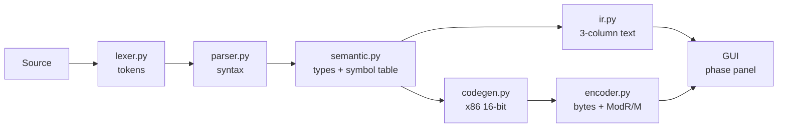

# Pyngo — a small multi-phase compiler

[](https://github.com/jsvdr/pyngoc/actions/workflows/ci.yml)

A phase-by-phase compiler (lexer → parser → semantic → intermediate code →
16-bit x86 object code) for a small language with `int`/`bool`,
`if`/`while`/`print` and the operators `@ # & | == > <`. The backend is
Flask, the frontend is vanilla HTML/CSS/JS, and there are no extra runtime
dependencies. The code is simple on purpose: it reads top to bottom, with no
AST.

The language grammar lives in [`docs/grammar.md`](docs/grammar.md) and the
error catalogue in [`docs/errors.md`](docs/errors.md).

## Architecture



The phases are chained: each one receives what the previous one left and they
do not share state. Each GUI button (`/tokens`, `/parser`, `/semantic`, `/ir`,
`/object`) re-runs the previous phases from the source; if one fails, the next
one does not run.

## Status

| Phase | Status |
|---|---|
| Lexer | ✅ |
| Parser (no AST) | ✅ |
| Semantic | ✅ |
| Intermediate code | ✅ |
| Optimizer | ⏳ to be defined |
| Object code (x86 16-bit) | ✅ (bytes verified with tests) |

## Run it (Python 3.12)

```bash
python -m venv .venv
source .venv/bin/activate  # Windows: .venv\Scripts\activate
pip install -r requirements.txt
PYTHONPATH=src python -m pyngo.app
```

Open `http://127.0.0.1:5000`. Development reload: `FLASK_DEBUG=1`.
If the port is busy: `PORT=5001 PYTHONPATH=src python -m pyngo.app`.

## With Docker (no Python install)

```bash
docker build -t pyngo .
docker run -p 5000:5000 pyngo
```

## How to review it (if something fails, run this first)

```bash
pip install -r requirements-dev.txt
pytest tests/ -q
ruff check src/ tests/
ruff format --check src/ tests/
pyright
```

`pyright` runs in `strict` mode with [`pyrightconfig.json`](pyrightconfig.json)
and analyzes only `src/` and `tests/`. In VSCode, open this folder
(`compiler/`) and select the `.venv/bin/python` interpreter: if the workspace is
a parent folder, Pylance does not find the config and reports the `pyngo`
imports as errors.

## Phases (one button per phase in the GUI)

| Button | Route | OK output |
|---|---|---|
| TOKENS | `POST /tokens` | token list |
| Parser | `POST /parser` | `Syntax OK` |
| Semantic | `POST /semantic` | `Semantic OK` |
| IR | `POST /ir` | Name/Operator/Attribute table |
| OBJECT CODE | `POST /object` | DATA and CODE tables (ADDRESS/CONTENT/HEX) |

## Intermediate code (IR)

The IR is painted as a **Name / Operator / Attribute** table. The generator
builds text lines (`MOV AX, a`) and splits them into those 3 columns.

Simple version: every expression is computed in `AX` and only **simple
operands** are allowed (variable, number or `true`/`false`), but operations at
the same level can be chained:

- `a @ b @ c` → `ADD AX, b` / `ADD AX, c`
- `a & b | c` → `MUL BX` / `DIV BX`
- `while (a < b) { ... }` → label at the start, `CMP` + jump, `JMP` back
- `bool` values are `DB`: loaded with `MOV AL` + `MOV AH, 0` and compared with `CMP AL`
- `print(x)` splits the value into `TENS` and `ONES` and prints them with
  `INT 21H` / `AH=02H`; the two-digit routine is correct for 0–99. `print`
  only accepts a variable, and values above 99 are not checked at compile time

If the stack were needed (for example `a @ b & c` or `( a @ b )`), the IR
button shows a clear error instead of generating code.

## Object code

The floating **OBJECT CODE** button opens a panel with two tables: **DATA**
(the variables) and **CODE** (the instructions). Each row shows
`ADDRESS | CONTENT | HEX`:

- `ADDRESS` is binary (16 bits in four nibbles): `0000 0000 0000 0000`.
- `CONTENT` comes from the real bytes, in nibbles: `1010 0001  0000 0010  0000 0000`.
- `HEX` is the same bytes in memory order: `A1 02 00`.
- Each row's tooltip shows the full instruction (`MOV AX,[0002h]`).

Conventions: `DATA_BASE = 0000h` (2 bytes per variable, `00 00`),
`CODE_BASE = 0000h`, W = 1, little endian, two's complement. Variables are
addressed directly (mod 00, r/m 110). The code ends in `HLT`; if the program
has `print`, the `print_routine` follows. It prints with `DIV DL` +
`INT 21H` / `AH=02H`, just like the IR, and adds `TENS` and `ONES` (1 byte
each) to the DATA table. Without `print`, the routine is not emitted.

`encoder.py` keeps the variants in tables (MOV, ADD/SUB/CMP, MUL/DIV, jumps
and stack) and builds the ModR/M byte. `codegen.py` walks the tokens in the
same shape as the parser and emits instructions. Jumps are assembled in two
passes: if the relative offset does not fit in −128..127, they are promoted to
near jumps (`E9` or `0F 8x`).

The four phases share `cursor.py`: a base class with `current_token()`,
`current_is()`, `advance()` and `advance_if()`, so the token-list and position
handling is not repeated in every file.

Comparisons use **unsigned** jumps (`>` → `JA`, `<` → `JB`): the language
handles 0..65535 and `MUL`/`DIV` are unsigned, so `40000 > 5` cannot be read
as a negative. `==` is still `JE`.

Example (`x` at 0000h, `y` at 0002h):

```text
x = y & 3;   → A1 02 00 · BB 03 00 · F7 E3 · A3 00 00
x = y | 3;   → A1 02 00 · BB 03 00 · BA 00 00 · F7 F3 · A3 00 00
```

The bytes are verified against the tables with unit tests.

## Technical decisions

- **No AST.** The parser only validates; the semantic analyzer and the
  generator copy its shape (same skeleton, same order). The price is walking
  the tokens again during generation; in exchange, there is no tree to
  maintain for a single consumer. If the optimizer needs one, we reopen the
  decision.
- **Registers, not a stack.** Everything is computed in `AX` (a single
  accumulator). That is why only simple operands and same-level operations
  are allowed: if an expression needed two live values at once, an error
  (`IRError`) is shown instead of generating wrong code.
- **`bool` values are `DB`** (1 byte, language rule): loaded with `MOV AL` +
  `MOV AH, 0` and compared with `CMP AL`, so `AX` always holds a full 0 or 1.
- **Comparisons are a value.** `== > <` leave 0/1 in `AX` with `SETcc` +
  `MOV AH, 0` (that is why `bool c = a == b` exists); in a condition the
  negated jump is emitted (`<` → `JGE`).
- **`print` uses the two-digit template**: `DIV DL` splits the number (tens
  in `TENS`, ones in `ONES`). It is correct from 0 to 99; values above that
  are a documented limitation.
- **Messages are fixed** (`Syntax OK`, `Semantic OK`,
  `Line X: TYPE ERROR: ...`): tests compare them exactly, so they are not
  reworded.
- **No runtime dependencies** beyond Flask: `ruff`, `pyright` and `pytest`
  are development tools (`requirements-dev.txt`).
- **Strict typing, no `Any` and no `type: ignore`.** `pyright` runs in
  `strict` mode with extra warnings (implicit override, unused call results).
  Domain types live in short aliases: `Operand` (encoder), `Row` and
  `PanelRow` (codegen).

## Example to try

```text
{
    int counter = 1;
    bool active = true;
    counter = counter @ 1;
}
```

## Structure

```text
src/pyngo/  tokens.py cursor.py lexer.py parser.py semantic.py
            ir.py encoder.py codegen.py app.py
web/        index.html script.js style.css
tests/      test_compiler.py test_encoder.py test_codegen.py
docs/       grammar.md errors.md
```

## How AI was used

AI assistants helped draft code, comments, tests and documentation. Every
generated byte is checked against the Intel instruction tables with unit
tests, and the object-code path is exercised by a seeded differential test
that runs random programs in a small x86-16 emulator and compares the output
with a reference interpreter. Suggestions that did not survive those checks
were discarded. The commit history keeps the fixes.
