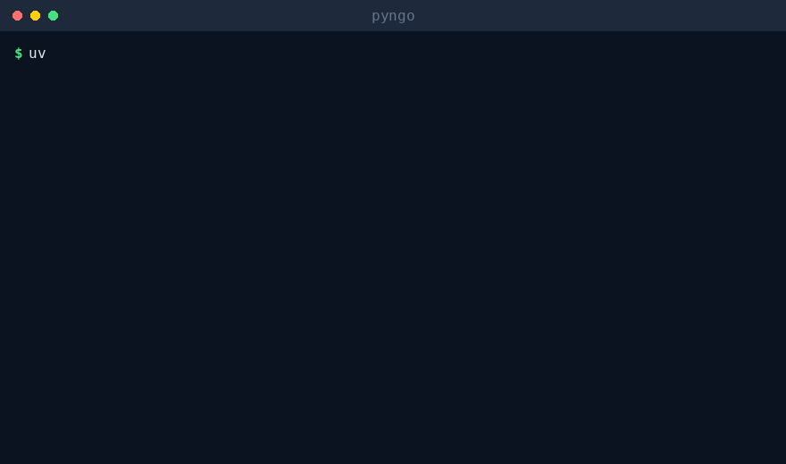

# Pyngo

**A small compiler, one phase at a time.** Lexer → parser → semantic analysis
→ intermediate code → 16-bit x86 object code, with a projector-friendly web UI
that shows every phase next to the next one.

[](https://github.com/jsvdr/pyngoc/actions/workflows/ci.yml)
[](https://github.com/jsvdr/pyngoc/actions/workflows/security.yml)
[](https://github.com/jsvdr/pyngoc/actions/workflows/fuzz.yml)
[](pyproject.toml)
[](https://github.com/astral-sh/ruff)
[](LICENSE)



The language has `int` and `bool`, `if` / `while` / `print`, and four
arithmetic operators (`@` add, `#` subtract, `&` multiply, `|` divide) plus
`==`, `>` and `<`. The object-code panel shows the real bytes of every
instruction, with its address, its binary content and its hex.

## Quick start

```bash
git clone https://github.com/jsvdr/pyngoc.git
cd pyngoc
uv sync
uv run pyngo serve          # → http://127.0.0.1:5000
```

`uv` installs Python 3.12 from `.python-version` if you do not have it.

Compile a file from the terminal:

```bash
$ uv run pyngo build examples/loop.pyn
Syntax OK
Semantic OK
IR
NAME        OPERATOR  ATTRIBUTE
            TITLE     Pyngo
...
WHILE_START_1:
            MOV       AX, i
            CMP       AX, 3
            JAE       WHILE_END_2
...
OBJECT CODE
DATA
ADDRESS             HEX     TEXT
0000 0000 0000 0000 00 00   i : int
...
CODE
ADDRESS             HEX                 TEXT
0000 0000 0000 0000 B8 00 00            MOV AX, 0
0000 0000 0000 0011 A3 00 00            MOV [0000h], AX
...
```

| Command | What it does |
|---|---|
| `uv run pyngo serve [--port 5001] [--debug]` | web UI (Flask development server) |
| `uv run pyngo build <file>` | phases, IR table and object code |
| `uv run pyngo check <file>` | lexer, parser and semantic analysis only |
| `uv run pyngo --version` | version |

## The pipeline

| Phase | Module | Output |
|---|---|---|
| Tokens | `src/pyngo/lexer.py` | `<TKN INT int>`, `<TKN ID counter>`, … |
| Syntax | `src/pyngo/parser.py` | `Syntax OK` or `Line X: …` |
| Semantics | `src/pyngo/semantic.py` | `Semantic OK` + symbol table |
| Intermediate code | `src/pyngo/ir.py` | `NAME / OPERATOR / ATTRIBUTE` rows |
| Object code | `src/pyngo/codegen.py` + `encoder.py` | `ADDRESS / CONTENT / HEX` rows |

Each GUI button (`TOKENS`, `Parser`, `Semantic`, `IR`, `OBJECT CODE`) re-runs
the phases from the source and stops at the first one that fails. Success is
green, errors are red, and nothing is shared between panels.

The grammar fits on one screen: [`docs/grammar.md`](docs/grammar.md).
The error strategy is explained in [`docs/errors.md`](docs/errors.md).

## Object code

`DATA` holds the variables (`int` = 2 bytes, `bool` = 1) and `CODE` holds the
instructions. For `x` at `0000h` and `y` at `0002h`:

```text
x = y & 3;   → A1 02 00 · BB 03 00 · F7 E3 · A3 00 00
x = y | 3;   → A1 02 00 · BB 03 00 · BA 00 00 · F7 F3 · A3 00 00
```

Every expression is computed in `AX`; `MUL` and `DIV` use `BX`, and `DX` is
cleared before a 16-bit division. Comparisons leave `0`/`1` in `AX` and use
the **unsigned** jumps (`JA`, `JB`), because `int` is `0..65535`. `print`
divides by 10 and writes the two digits with `INT 21H` / `AH=02H` through a
`print_routine` that reads its argument with `MOV BP, SP` / `MOV AX, [BP+2]`.

Jumps are always near, and they are assembled in two passes: the first one
computes the address of every label, the second one encodes the relative
offset. `encoder.py` owns the tables (ModR/M composition included) and raises
`EncoderError` for anything outside the emitted subset.

## Tests

```bash
uv run pytest        # 432 tests
```

- `tests/test_compiler.py` — the contract of the front end, with exact
  messages.
- `tests/test_encoder.py` — every encoding, in hex and in nibbles.
- `tests/test_codegen.py` — addresses, bytes, jumps and the two examples above.
- `tests/test_differential.py` — 300 programs from a fixed seed are compiled,
  executed in a small x86-16 emulator and compared with an independent
  reference interpreter: printed text **and** final variable values. The
  emulator keeps data and stack in separate segments, like real mode.
- `tests/test_app.py` — the headers, the 64 KB limit and the JSON errors.
- `tests/test_cli.py` — the `--json` form that `pyngo-run` consumes.

```bash
uv run ruff check .
uv run ruff format --check .
uv run pyright        # strict
uv run pre-commit run --all-files
```

## Security

The web app has a small attack surface and is treated that way:

- **No code execution.** A pasted program is lexed, parsed and compiled; it is
  never executed by Python. The only executor is the x86 emulator in the
  tests.
- **Input limits.** 64 KB per request body (`MAX_CONTENT_LENGTH`) answered
  with a JSON `413`; deeply nested programs and literals that do not fit in
  16 bits answered with a JSON `400` or a normal `TYPE ERROR`.
- **Browser hardening.** A strict `Content-Security-Policy`
  (`default-src 'none'`, no inline script), `X-Content-Type-Options:
  nosniff`, `X-Frame-Options: DENY`, `Referrer-Policy: no-referrer`,
  `Permissions-Policy`, HSTS and `Cache-Control: no-store` on analysis
  answers. The UI paints with `textContent`, never `innerHTML`.
- **Container.** It runs as an unprivileged user and needs no writable path:

  ```bash
  docker run --read-only --tmpfs /tmp -p 5000:5000 pyngo
  ```

- **CI.** `pip-audit` against the exported lock, `bandit`, `semgrep`
  (`p/python`), a Trivy scan of the image (HIGH/CRITICAL, fixed only) and an
  Atheris run that sends arbitrary text through every phase and into the
  emulator.

[`SECURITY.md`](SECURITY.md) has the threat model and how to report a
problem.

## Run the object code (Go)

`pyngo build` stops at bytes. [`tools/pyngo-run`](tools/pyngo-run) executes
them:

```bash
uv run pyngo build examples/loop.pyn --json > loop.json
cd tools/pyngo-run
go run . ../../loop.json        # prints 03
go run . -vars ../../loop.json  # also prints i = 3, TENS = 0, ONES = 3
```

It is a small 8086 executor for exactly the instructions the compiler emits:
64 KB data and stack segments, `MOV`/`ADD`/`SUB`/`CMP`/`MUL`/`DIV`,
`PUSH`/`POP`, jumps, `CALL`/`RET`, `INT 21H` with `AH=02H` and `HLT`. It has
no dependency outside the Go standard library, and its golden tests compare
the output **and** the instruction count with the Python emulator, so a
decoding difference cannot pass unnoticed.

## Documentation

| Document | Contents |
|---|---|
| [`docs/grammar.md`](docs/grammar.md) | the grammar, one line per production |
| [`docs/errors.md`](docs/errors.md) | how each error is detected, as pseudocode |
| [`docs/architecture.md`](docs/architecture.md) | modules, data crossing each boundary, Mermaid diagram |
| [`docs/limitations.md`](docs/limitations.md) | everything the compiler does not do |
| [`docs/adr/`](docs/adr) | five architecture decision records |
| [`CHANGELOG.md`](CHANGELOG.md) | versions |
| [`CONTRIBUTING.md`](CONTRIBUTING.md) | setup, style, commit prefixes |

A Spanish summary of the project is in [`README.es.md`](README.es.md).

## Run it with Docker or deploy it

```bash
docker build -t pyngo .
docker run -p 5000:5000 pyngo
# with a read-only root filesystem, as the app needs no writable path:
docker run --read-only --tmpfs /tmp -p 5000:5000 pyngo
```

The image is two stages: `ghcr.io/astral-sh/uv` resolves and installs the
dependencies, then a slim `python:3.12-slim` runs `gunicorn` as the unprivileged
user `pyngo` (uid 10001) on `$PORT` (5000 by default), with a `HEALTHCHECK`
that polls `/healthz` (`{"status": "ok"}`).

[`render.yaml`](render.yaml) deploys the same image as a Render web service
with a health check. The free plan sleeps after inactivity, so the first
request after a while takes **30–50 s**; after that it answers in
milliseconds.

## Project layout

```text
src/pyngo/   tokens.py cursor.py lexer.py parser.py semantic.py
             ir.py encoder.py codegen.py app.py cli.py
web/         index.html script.js style.css
tests/       test_compiler.py test_encoder.py test_codegen.py test_app.py
             test_cli.py test_differential.py differential/ fuzz/
tools/       pyngo-run/ (Go executor: main.go object.go machine.go)
docs/        grammar.md errors.md architecture.md limitations.md adr/ demo.gif
examples/    loop.pyn
```

## How AI was used

AI assistants helped draft code, comments, tests and documentation, and the
pull requests were reviewed by a human. Nothing here is trusted because a
model produced it:

- every encoding is checked against the instruction tables by a unit test
  (`tests/test_encoder.py`, hex and nibbles);
- the object code is checked by a differential test that runs 300 seeded
  random programs in an emulator and compares the result with an independent
  reference interpreter (`tests/test_differential.py`);
- `ruff`, `ruff format`, `pyright --strict` and `pytest` run in CI on Python
  3.12, 3.13 and 3.14.

Suggestions that did not survive those checks were discarded; the commit
history keeps the fixes.

## License

MIT — see [`LICENSE`](LICENSE).
