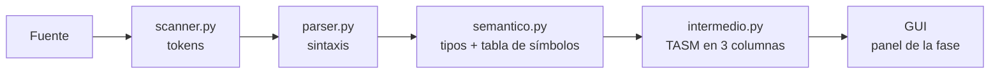

# Pyngo — compilador didáctico

[](https://github.com/jsvdr/pyngoc/actions/workflows/ci.yml)

Compilador por fases (scanner → parser → semántico → código intermedio)
para un lenguaje propio con `int`/`bool`, `if`/`while`/`print` y operadores
`@ # & | == > <`. Backend en Flask, frontend vanilla, sin dependencias de más.
Código simple a propósito: se lee de arriba a abajo, sin AST.

La gramática del lenguaje está en [`docs/gramatica.md`](docs/gramatica.md)
y el catálogo de errores en [`docs/errores.md`](docs/errores.md).

## Arquitectura



Las fases están encadenadas: cada una recibe lo que dejó la anterior y no
comparten estado. Cada botón de la GUI (`/analizar`, `/parser`, `/semantico`,
`/intermedio`) re-corre las fases previas desde el fuente; si una falla, la que
sigue no se ejecuta.

## Estado

| Fase | Estado |
|---|---|
| Scanner | ✅ |
| Parser (sin AST) | ✅ |
| Semántico | ✅ |
| Código intermedio (TASM) | ✅ |
| Optimizador | ⏳ por definir |
| Código máquina | ⏳ por definir |

## Cómo correrlo (Python 3.12)

```bash
python -m venv .venv
source .venv/bin/activate  # Windows: .venv\Scripts\activate
pip install -r requirements.txt
python backend/app.py
```

Abre `http://127.0.0.1:5000`. Desarrollo con recarga: `FLASK_DEBUG=1`.
Si el puerto está ocupado: `PORT=5001 python backend/app.py`.

## Con Docker (sin instalar Python)

```bash
docker build -t pyngo .
docker run -p 5000:5000 pyngo
```

## Cómo revisarlo (si algo falla, corre esto primero)

```bash
pip install -r requirements-dev.txt
pytest tests/ -q
ruff check backend/ tests/
ruff format --check backend/ tests/
pyright
```

## Fases (un botón por fase en la GUI)

| Botón | Ruta | Salida OK |
|---|---|---|
| TOKENS | `POST /analizar` | lista de tokens |
| Parser | `POST /parser` | `Syntax OK` |
| Semántico | `POST /semantico` | `Semantic OK` |
| CI | `POST /intermedio` | tabla Nombre/Operador/Atributo |

## Código intermedio (CI)

El CI se pinta como tabla **Nombre / Operador / Atributo**. El generador arma
líneas TASM (`MOV AX, a`) y al final las parte en esas 3 columnas.

Versión sencilla: cada expresión se calcula en `AX` y solo se admiten
**operandos simples** (variable, número o `true`/`false`), pero se pueden
encadenar operaciones del mismo nivel:

- `a @ b @ c` → `ADD AX, b` / `ADD AX, c`
- `a & b | c` → `MUL BX` / `DIV BX`
- `while (a < b) { ... }` → etiqueta al inicio, `CMP` + salto, `JMP` de vuelta
- los `bool` son `DB`: se cargan con `MOV AL` + `MOV AH, 0` y se comparan con `CMP AL`
- `print(x)` parte el valor en `COC` (decenas) y `RESI` (unidades) y los imprime
  con `INT 21H` / `AH=02H`; un literal fuera de 0–99 se rechaza con un error
  claro, porque la plantilla imprime 2 cifras

Si hiciera falta la pila (por ejemplo `a @ b & c` o `( a @ b )`), el botón CI
muestra un error claro en vez de generar código.

## Decisiones técnicas

- **Sin AST.** El parser solo valida; el semántico y el generador copian su
  forma (mismo esqueleto, mismo orden). El precio es recorrer los tokens otra
  vez al generar; a cambio, no hay un árbol que mantener para un solo
  consumidor. Si el optimizador lo pide, se reabre la decisión.
- **Registros, no pila.** Todo se calcula en `AX` (un solo acumulador). Por eso
  solo se admiten operandos simples y operaciones del mismo nivel: si una
  expresión necesitara dos valores vivos a la vez, se muestra un error
  (`ErrorIntermedio`) en vez de generar código mal.
- **Los `bool` son `DB`** (1 byte, regla del profe): se cargan con `MOV AL` +
  `MOV AH, 0` y se comparan con `CMP AL`, así `AX` siempre vale 0 o 1 completo.
- **Las comparaciones son un valor.** `== > <` dejan 0/1 en `AX` con `SETcc` +
  `MOV AH, 0` (por eso existe `bool c = a == b`); en una condición se emite el
  salto negado (`<` → `JGE`).
- **El `print` usa la plantilla de 2 cifras** del handout (`DIV DL` parte el
  número: decenas en `COC`, unidades en `RESI`). Es correcto de 0 a 99; un
  literal fuera de rango se rechaza con un mensaje claro.
- **Los mensajes son fijos** (`Syntax OK`, `Semantic OK`,
  `Línea X: ERROR DE TIPOS: ...`): los tests los comparan exactos, así que no se
  reformulan.
- **El dominio va en castellano** (`tabla`, `linea`, `decl_var`); Flask, JS y
  TASM quedan en inglés porque es vocabulario técnico.
- **Sin dependencias de ejecución** más que Flask: `ruff`, `pyright` y `pytest`
  son de desarrollo (`requirements-dev.txt`).

## Ejemplo para probar

```text
{
    int contador = 1;
    bool activo = true;
    contador = contador @ 1;
}
```

## Estructura

```text
backend/   tokens.py scanner.py parser.py semantico.py intermedio.py app.py
frontend/  index.html script.js style.css
tests/     test_smoke.py (casos de humo)
docs/      gramatica.md errores.md
```
