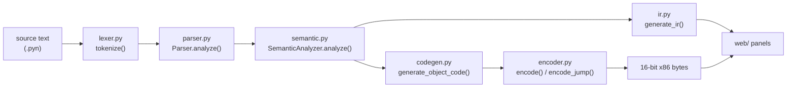

# Architecture

Pyngo is a chain of seven small modules. Each one receives what the previous
one produced and returns a simple value: a list of tokens, a boolean, a
dictionary, a list of rows. Nothing is shared through global state, so every
phase can be tested on its own.

## Data that crosses each boundary

| Phase | Input | Output |
|---|---|---|
| `lexer.py` | source text | `list[Token]`, `list[str]` errors |
| `parser.py` | tokens | `(bool, list[str])` — `Syntax OK` or messages |
| `semantic.py` | tokens | `(bool, list[str])` + `dict[str, str]` symbol table |
| `ir.py` | symbol table + tokens | rows `(name, operator, attribute)` |
| `codegen.py` | tokens + symbol table | DATA and CODE panel rows |
| `encoder.py` | mnemonic + operands | `list[int]` bytes |

## The token cursor

`cursor.py` holds the four methods the four token walkers share
(`current_token`, `current_is`, `advance`, `advance_if`). `Parser`,
`SemanticAnalyzer`, `IRGenerator` and `CodeGenerator` inherit from it and add
their own grammar methods, with the same names as the productions in
[`grammar.md`](grammar.md).

Because there is no AST, each walker re-reads the token list from the
beginning: the parser validates, the semantic analyzer types, and the two
generators emit. That is the price of not maintaining a tree; see
[ADR 0001](adr/0001-no-ast.md).

## Two back ends

The same language has two outputs:

- **`ir.py`** builds lines of text (`MOV AX, a`) and splits them into the
  three columns of the IR panel. It is the didactic view of the assembly.
- **`codegen.py`** builds `Instruction` / `Jump` / `Label` objects and calls
  `encoder.py` to turn each one into bytes. Jumps are resolved in two passes,
  because their size depends on the distance.

Both walk the tokens in the same order, so their output is directly
comparable in the GUI.

## Web layer

`app.py` is a Flask app with one route per phase:

| Route | Runs |
|---|---|
| `POST /tokens` | lexer |
| `POST /parser` | lexer + parser |
| `POST /semantic` | lexer + parser + semantic |
| `POST /ir` | … + IR generator |
| `POST /object` | … + object code generator |
| `GET /healthz` | nothing (liveness probe) |

Each route re-runs the previous phases from the source, so a broken program
always stops at the phase that found the problem. The frontend
(`web/script.js`) only paints strings with `textContent`; user code is never
executed and never injected as HTML.
